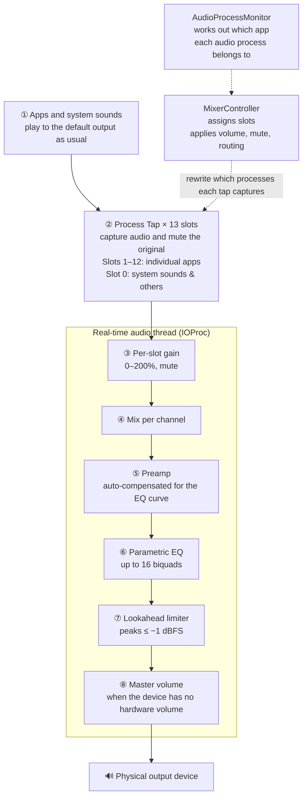
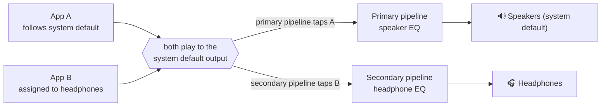

<p align="center">
  
</p>

<h1 align="center">Tonefleur</h1>

<p align="center">
  A macOS menu bar audio tool: system-wide equalizer, per-app mixer, and output device management.<br>
  No audio driver to install.<br>
  <sub>English · <a href="README.zh-TW.md">繁體中文</a> · formerly SoundDeck</sub>
</p>

---

## Highlights

- **Driverless system-wide audio processing.** Built on the Core Audio Process Tap API (macOS 14.2+) instead of a virtual audio driver. Nothing to install, and if the app quits or crashes, macOS automatically restores normal playback.
- **Real-time DSP written from scratch in Swift:** parametric biquad EQ, a linked lookahead peak limiter, a per-channel mixer for 1–16 channels (stereo, 5.1, 7.1), and an FFT spectrum analyzer (vDSP). The render path is allocation-free and lock-free.
- **Per-app routing.** Each app can play to a different output device, with an independent EQ for each device. Apps move between pipelines without glitches or audio leaking out.
- **Shipped and maintained:** universal binary (Apple silicon + Intel), signed DMG releases, Sparkle auto-updates with EdDSA signatures, English and Traditional Chinese UI, and 32 unit tests.

## Features

| Feature | Description |
|---|---|
| **Parametric EQ** | Up to 16 bands, six filter types (peak, low shelf, high shelf, high-pass, low-pass, notch), and a draggable frequency-response curve |
| **Spectrum analyzer** | Shows live per-frequency levels of what's playing behind the EQ curve, so you can see what to boost or cut |
| **Per-device EQ** | Headphones, speakers and soundbars each keep their own EQ, applied automatically when you switch outputs |
| **EQ presets** | Built-in Flat, Bass Boost, Treble Boost, Vocal Clarity, Band and Loudness presets; save, rename and delete your own |
| **EQ import** | Import [AutoEQ](https://github.com/jaakkopasanen/AutoEq) headphone corrections, or copy a template, ask an AI for settings that suit your music, and paste the reply back |
| **App mixer** | One row per app that is playing sound, with volume (0–200%), mute and a live level meter |
| **Per-app output** | For example, music on the speakers and calls on headphones. Off by default; one click resets every app to the system default |
| **Output devices** | One-click output switching; volume control even for devices without it, like HDMI displays (software volume) |
| **Balance** | Left/right balance, remembered per output device |
| **Limiter** | Keeps peaks below −1 dBFS when EQ boosts or app volumes above 100% would clip |
| **Auto-update** | Notifies you when a new version is available (can be turned off) |
| **Other** | Launch at login, automatic recovery after sleep/wake, automatic shutdown if output level runs away |

The UI is available in English and Traditional Chinese and follows the system language; other system languages fall back to English. You can also pick Tonefleur's language in **System Settings → General → Language & Region → Applications**.

## Requirements

- macOS 15 Sequoia or later
- Apple silicon or Intel Mac

## Installation

### Download

1. Download the latest `Tonefleur-<version>.dmg` from [Releases](../../releases).
2. Open the DMG and drag **Tonefleur** into **Applications**.
3. Open Tonefleur from Applications. The first time, macOS blocks it with "Apple could not verify…". This is expected (see below):
   1. Click **Done** to dismiss the alert.
   2. Open **System Settings → Privacy & Security**, scroll to the bottom and click **Open Anyway** next to the Tonefleur message, then confirm with your login password.
   3. From then on it opens normally.
4. When macOS asks whether Tonefleur may record **system audio**, click **Allow**. Tonefleur cannot process sound without it. See [Privacy](#privacy) for why it needs this and how it uses it.
5. The Tonefleur icon (three vertical sliders) in the menu bar means it is running.

When a new version comes out, Tonefleur will tell you; just click **Install Update**. You can also click **Check for Updates…** at the bottom of the panel.

> **Why is it blocked?** The app is not notarized by Apple (that requires a paid Apple Developer account), so macOS can't verify the developer. All the source code is in this repo, and you can build it yourself.
>
> If you can't find **Open Anyway**, you can remove the quarantine flag in Terminal and then open the app:
>
> ```bash
> xattr -dr com.apple.quarantine /Applications/Tonefleur.app
> ```

## Privacy

Tonefleur needs the "Screen & System Audio Recording" permission, which sounds like it records you. Here is exactly what it does and doesn't do.

**Why it needs the permission:** to equalize and mix sound, Tonefleur first has to receive each app's audio and then play it back after processing. macOS requires this permission for any program that reads another app's audio; every system-wide EQ tool of this kind needs it (tools built on virtual audio drivers ask for microphone permission instead).

**What Tonefleur never does**

- It never saves audio to a file. Audio is processed in memory in real time and sent straight to the speakers.
- It never sends audio or any personal data over the network.
- It collects no usage statistics and contains no analytics or ad SDKs.

**The only network feature is auto-update:** once a day it downloads `appcast.xml` from GitHub to check for a new version, and downloads the DMG from GitHub Releases when there is one. No system information is sent (Sparkle's system profiling is turned off). If you turn off **Check for updates automatically** at the bottom of the panel, Tonefleur never connects to the network unless you click **Check for Updates…**.

**How to verify this yourself**

- All the code is public. The only networking code is the Sparkle call in [`Sources/App/Updater.swift`](Sources/App/Updater.swift); nothing else opens a connection or writes audio files.
- Watch it with a firewall such as [LuLu](https://objective-see.org/products/lulu.html) or Little Snitch: Tonefleur only connects to `raw.githubusercontent.com` (update check) and `github.com` (update download).
- Build it from source, or compare the SHA-256 checksum attached to each release.
- You can revoke the permission at any time in **System Settings → Privacy & Security → Screen & System Audio Recording**. Tonefleur then receives no audio, and sound plays the way it normally would.

### Building from source

Requires macOS 15 or later and Xcode (Command Line Tools alone also work, but only build for the current architecture).

```bash
git clone https://github.com/kawaisumi/Tonefleur.git
cd Tonefleur
./Scripts/install.sh        # build, install to /Applications and launch
```

Create a stable signing certificate first, or **macOS will ask for the recording permission again after every rebuild** (see [Development](#development)).

## Usage

Click the Tonefleur icon in the menu bar to open the panel:

- **Top-right switch:** master on/off. When off, audio goes straight to the output with no processing.
- **Volume:** volume of the current output device. Devices without hardware volume (such as HDMI displays) automatically use software volume.
- **Balance:** the L/R slider below the volume; click the value on the right to re-center.
- **Output Device:** click to switch the system output.
- **Mixer:** volume, mute and level per app.
  - With **Per-app output** on, each row gets a speaker icon for sending that app to another device.
  - If an assigned device is unplugged, the app falls back to the system default and moves back when the device returns.
  - **System sounds & others** collects notification sounds, system sounds and anything that can't be attributed to a specific app.
- **Equalizer:** pick a preset, or click **Edit…** to open the editor.
  - Drag a point to change frequency and gain; hold `Shift` for fine adjustment; double-click a point to reset its gain to zero.
  - Choose which output device's EQ to edit at the top of the editor.
  - The gray area behind the curve is the spectrum: how loud each frequency is in what's playing right now. Play a song you know well, cut where it's too prominent and boost where it's lacking. It only appears while the device being edited is playing, and can be hidden with **Show spectrum**.
  - Click **Import** at the top right of the editor to import settings (see below).

### Importing EQ settings

The import window accepts the Equalizer APO parametric EQ format, the same format as AutoEQ's `ParametricEQ.txt`:

```
# Name: Band
Preamp: -3.0 dB
Filter 1: ON LSC Fc 90 Hz Gain 3.0 dB Q 0.71
Filter 2: ON PK Fc 250 Hz Gain -1.5 dB Q 1.40
Filter 3: ON HSC Fc 9000 Hz Gain 2.0 dB Q 0.71
```

**Headphone correction (AutoEQ):** AutoEQ has computed EQ curves that flatten the frequency response of thousands of headphones, based on measurements. Find your model in [AutoEQ's results folder](https://github.com/jaakkopasanen/AutoEq/tree/master/results), download `<model> ParametricEQ.txt`, and click **Choose File…** in the import window. AutoEQ results are already parametric, so Tonefleur applies the exact values without converting them to fixed bands.

**Let an AI tune it:**

1. Click **Copy AI Template** in the import window. The template already describes the format and value ranges Tonefleur accepts and includes the current device name; if you've already adjusted the EQ, your current settings are included as a starting point.
2. Paste it into ChatGPT, Claude or another AI and fill in the bracketed parts: your playback device, the music you listen to, and the sound you want.
3. Paste the AI's **entire reply** back into the import window (or click **Paste from Clipboard**). Tonefleur reads only the correctly formatted lines and ignores the rest.
4. Check the preview, then click **Apply** or **Apply and Save as Preset**.

Out-of-range values are clamped and unsupported filter types are skipped; the preview lists both. The file's Preamp is informational only: after import, preamp is always computed automatically.

**Copy Current Settings** exports the current EQ in the same text format, so you can share it with friends who import it the same way.

## How it works

### Overview

Tonefleur doesn't install a virtual audio device. It uses the **Core Audio Process Tap** API (available since macOS 14.2) to intercept each app's audio, processes it, and plays it on the physical device:



1. **Capture:** each tap captures what specific processes send to a specific output device, and mutes the original while it's being read. If Tonefleur stops reading (quits or crashes), macOS automatically resumes direct playback, so sound never goes silent.
2. **Slots:** each pipeline has 13 fixed taps. Slots 1–12 each serve one app; slot 0 runs in *excluding* mode and captures everything not assigned elsewhere, so the EQ still applies to all audio.
3. **Processing:** a private aggregate device (physical speaker as sub-device, taps as inputs) runs an IOProc that applies gain, mixing, preamp, EQ, limiter and volume, then writes to the speaker.
4. **Live changes:** when apps start or stop playing, Tonefleur only rewrites *which processes* each tap captures. Nothing is rebuilt and audio isn't interrupted.

### Routing an app to another device

Apps always play to the **system default output**. To send an app to another device, that device's pipeline taps "this app's audio going to the default output" and plays it on its own device:



- The **primary pipeline** sits on the system default output and always exists while Tonefleur is enabled.
- **Secondary pipelines** are created when an app is assigned to another device and torn down when no app uses them.
- Each pipeline has its own EQ, which is where per-device EQ comes from.
- When an app moves between pipelines, the new one takes over before the old one lets go: a brief overlap is better than the original audio leaking out.

### Why not a virtual audio driver

| | Virtual audio driver | Core Audio Process Tap (Tonefleur) |
|---|---|---|
| Installation | Admin install, restart the audio service | Nothing to install; just grant the recording permission |
| Per-app separation | The driver must identify apps itself | The API targets processes directly |
| On crash | Output can get stuck on the virtual device, leaving no sound | Original output resumes automatically |
| System volume keys | Control the virtual device | Still control the physical device |
| Downsides | High maintenance; OS updates break it | Requires macOS 14.2+; new API with sparse documentation |

## Design details

<details>
<summary><b>Attributing audio to an app</b></summary>

Audio from browsers and Electron apps actually comes from helper processes (e.g. `Google Chrome Helper`, `com.apple.WebKit.GPU`). Tonefleur checks, in order:

1. The audio process itself
2. The process the system records as "responsible" (`responsibility_get_pid_responsible_for_pid`, a private API loaded via `dlsym` and skipped if unavailable)
3. Parent processes

The first one that is a regular app is the owner. Helpers nested inside another app (e.g. `Discord.app/Contents/Frameworks/Discord Helper.app`) look like apps to the system, so Tonefleur keeps walking up to the outermost app bundle.

It doesn't exclude system processes by checking for a `com.apple.*` bundle ID, because Safari, Music and Podcasts are `com.apple.*` too.

</details>

<details>
<summary><b>When an app appears in the mixer</b></summary>

- While it's playing, and for 30 seconds after it stops (shown grayed out, so you can adjust a paused app).
- Apps whose volume, mute or routing you've changed stay visible as long as they use audio, and keep a slot reserved, so a muted app never leaks sound when it starts playing.
- Settings are remembered by bundle ID across app restarts.

</details>

<details>
<summary><b>Real-time thread</b></summary>

The IOProc runs on the real-time audio thread, where allocating memory or waiting on a lock causes dropouts:

- All buffers and state are allocated when the pipeline is built; the IOProc only receives raw pointers, with no ARC traffic.
- EQ coefficients are computed on the UI thread and handed over with `os_unfair_lock`; the real-time side only uses `trylock` and keeps the old parameters if it can't get the lock, retrying on the next buffer.
- Coefficient, gain and volume changes are ramped linearly across one buffer, so dragging EQ points or sliders doesn't click.
- Meter peaks are written by the real-time side and only read by the UI while the panel is open.

</details>

<details>
<summary><b>Limiter</b></summary>

A lookahead peak limiter linked across channels: the signal is delayed by about 0.67 ms so gain can ramp down linearly before a peak arrives, with a release time constant of about 120 ms. The algorithm guarantees output never exceeds −1 dBFS (verified by unit tests), so no extra soft clipper is needed.

</details>

<details>
<summary><b>Safety mechanisms</b></summary>

- **Device-scoped taps only:** no global taps. If another audio forwarding tool is running (virtual device → physical speaker), a global tap would capture its forwarded audio again and send it back, creating feedback.
- **Feedback protection:** if any tap's raw signal exceeds +12 dBFS or contains NaN, the real-time side outputs silence immediately; the engine then shuts down and the UI explains why.
- **No audio flowing:** if a pipeline receives no audio within 20 seconds of starting (usually because the recording permission hasn't been granted), the UI shows why and retries every 5 seconds.
- **Sleep and wake:** pipelines are torn down before sleep and rebuilt about 1 second after wake, retrying at 1, 2 and 4 second intervals on failure.

</details>

<details>
<summary><b>Channels (stereo, 5.1, 7.1)</b></summary>

A pipeline has as many channels as its output device. Taps deliver audio in the device's format, so every channel is mixed, processed and output in place, with no downmixing: on a 5.1 device, center (dialogue), LFE and surround channels stay where they belong.

- **EQ:** the same settings apply to every channel, each with its own filter state.
- **Limiter:** looks at all channels together; if any channel is too loud, all are reduced together, preserving the balance between them and the spatial image.
- **Balance:** uses the device's reported channel layout. Panning left attenuates right-side channels (front right, surround right…); center and LFE are unaffected. If the reported layout is incomplete, stereo is treated as L/R and 6/8 channels as standard 5.1/7.1.
- **Spectrum:** shows the average across all channels.

On a stereo device, apps or macOS downmix 5.1 content before it's sent out. That happens before Tonefleur and is unrelated to it.

</details>

## Known limitations

- Multichannel output devices (5.1, 7.1, up to 16 channels) are supported but have only been tested with a simulated 5.1 device, not real surround hardware yet.
- When a player sends Dolby Digital, DTS or Atmos **bitstream to a receiver** (passthrough), the data is compressed, not a waveform. Tonefleur can't process it; no system EQ can.
- Up to 12 apps get their own row at a time; the rest go into "System sounds & others".
- Each pipeline uses 13 taps; the more output devices in use at once, the more load on the system audio service (`coreaudiod`).
- An assigned device without hardware volume only gets master volume control when it's the system default (apps routed to it can still use their own sliders).
- Secondary pipelines don't auto-retry if no audio flows after starting (the primary pipeline does); the app's audio stays on the system default output.
- Some HDMI devices take an inconsistent amount of time to start a pipeline (from under 1 second to over 20). Automatic retry handles it for now; the root cause is unknown.
- A few pro audio interfaces split channels across multiple streams; only the first stream is handled.
- Running alongside other tools that capture or forward system audio (other system EQs, audio routers) makes no sense; pick one.
- Balance is applied in Tonefleur's pipeline, so it has no effect when processing is off.

## Development

### Project layout

```
Tonefleur/
├── Package.swift
├── Sources/
│   ├── AudioCore/                 # Audio core, independent of the UI
│   │   ├── HAL/                   # Thin wrappers over Core Audio properties
│   │   ├── Devices/               # Output device listing, switching, master and software volume
│   │   ├── Processes/             # Audio process listing and app attribution
│   │   ├── Tap/                   # Process Tap
│   │   ├── Pipeline/              # OutputPipeline: aggregate device, IOProc, real-time processing per output
│   │   ├── DSP/                   # Biquad, parametric EQ, limiter, EQ settings and presets, import/export
│   │   ├── Mixer/                 # MixerController: slot allocation, per-app volume and routing
│   │   └── Engine/                # AudioEngine: manages pipelines and routing
│   └── App/                       # SwiftUI: menu bar panel, mixer, EQ editor, auto-update
├── Tests/AudioCoreTests/          # Unit tests for DSP, import format and attribution
├── Resources/                     # Info.plist, app icon, en.lproj / zh-Hant.lproj translations
├── LICENSE                        # MIT License
└── Scripts/                       # Build, packaging, signing, icon
```

### Scripts

| Command | Purpose |
|---|---|
| `./Scripts/bundle.sh [release\|debug]` | Build and assemble `build/Tonefleur.app`. Release builds are universal (Apple silicon + Intel) |
| `./Scripts/install.sh` | Build, install to `/Applications` and launch |
| `./Scripts/make-dmg.sh` | Package `build/Tonefleur-<version>.dmg` |
| `./Scripts/set-version.sh <version>` | Set the version and bump the build number |
| `./Scripts/setup-updates.sh` | Create the auto-update signing key (run once) |
| `./Scripts/release.sh` | Package, sign the update and update `appcast.xml` |
| `python3 Scripts/check-localization.py` | Check for UI strings missing an English translation |
| `./Scripts/create-signing-cert.sh` | Create a self-signed code signing certificate `SoundDeck Dev` in the login keychain |
| `./Scripts/make-icon.sh` | Regenerate the app icon from `make-icon.swift` |
| `swift test` | Run unit tests |

### Signing and the recording permission

macOS ties the recording permission to the code signature. Without a certificate, `bundle.sh` signs ad hoc, which produces a different signature on every build, so **you have to grant the permission again after every rebuild**. Run this once:

```bash
./Scripts/create-signing-cert.sh
```

It creates a local self-signed certificate trusted only for code signing (macOS will ask for your login password), and `bundle.sh` uses it automatically from then on. Set `TONEFLEUR_SIGN_IDENTITY` to use a different certificate.

### How auto-update works

Tonefleur uses [Sparkle](https://sparkle-project.org). Once a day the app checks `appcast.xml` in this repo, which lists each version's number and DMG download URL (on GitHub Releases). Every DMG is signed with an EdDSA private key, and the app embeds the matching public key (`SUPublicEDKey` in `Info.plist`); updates with a bad signature are rejected.

Before your first release, run this once on your machine:

```bash
./Scripts/setup-updates.sh
```

It creates the private key in the login keychain and writes the public key into `Info.plist`. **If the private key is lost, you can no longer ship updates to existing installs**, so export a backup as the script instructs (never into the repo). Builds without a public key (e.g. someone else's build) don't enable auto-update or show **Check for Updates…**.

`appcast.xml` points to the `kawaisumi/Tonefleur` repo by default. For a different repo, change `SUFeedURL` in `Info.plist` and set `TONEFLEUR_GITHUB_REPO` when running `release.sh`.

### Releasing a new version

1. Set the version: `./Scripts/set-version.sh 1.1.0`. Versions are major.minor.patch: bump the last number for bug fixes (1.0.0 → 1.0.1) and the middle one for new features (1.0.1 → 1.1.0). The script also bumps the build number.
2. Run `./Scripts/release.sh`: it packages the DMG, signs it, adds the version to `appcast.xml` and prints the checksum.
3. Follow the steps it prints, in order: commit and tag → push the tag → create the GitHub release and upload the DMG → push `main` last. The order matters: as soon as `appcast.xml` is pushed, existing users get notified, so the DMG must already be downloadable.

The current version is shown at the bottom right of the panel, left of **Quit**; hover over it to see the build number.

Always sign releases with the **same certificate**. If it changes, users have to grant the recording permission again after updating. Export `SoundDeck Dev` from Keychain Access as a `.p12` backup (never into the repo).

### Diagnostics

```bash
# Log levels per pipeline and per app every 2 seconds
open build/Tonefleur.app --args --log-stats
/usr/bin/log stream --predicate 'subsystem == "local.sounddeck.app"' --style compact

# Print detected output devices / apps the mixer would show, then exit
./build/Tonefleur.app/Contents/MacOS/Tonefleur --dump-devices
./build/Tonefleur.app/Contents/MacOS/Tonefleur --dump-apps

# Open the panel and EQ editor as regular windows and save PNGs after 4 seconds
# (add -AppleLanguages "(en)" to check the English UI)
open build/Tonefleur.app --args --preview --preview-snapshot <folder>

# 8 seconds after launch, route an app to a device; restore after 10 seconds
open build/Tonefleur.app --args --log-stats --route-test <bundle ID> <device name>
```

## Development history

| Milestone | Scope |
|---|---|
| M0 | Proof of concept: Process Tap + aggregate device forwarding system audio, feedback protection |
| M1 | Output device management, software volume, sleep/wake, automatic retry on startup failure |
| M2 | Parametric EQ, lookahead limiter, EQ editor, built-in presets |
| M3 | App mixer: 13 fixed tap slots, helper process attribution |
| M4 | Per-app output routing, multiple pipelines, per-device EQ |
| M5 | Custom presets, launch at login, UI polish, app icon, DMG packaging |
| M6 | AutoEQ / Equalizer APO import, AI parameter template, export current settings |
| M7 | Balance, auto-update (Sparkle), spectrum analyzer, English UI |
| M8 | Multichannel output (5.1, 7.1, etc.): every channel processed in place instead of keeping only front L/R |

### Possible future work

- Global hotkeys (switch device, toggle EQ, switch preset)
- Search AutoEQ headphones inside the app (currently you download the file from the site)
- Input device (microphone) selection and volume
- Per-app EQ
- Graphic EQ (a simple fixed 10-band interface)

## References and acknowledgments

- [Sparkle](https://sparkle-project.org): auto-update (MIT License; full license text included in the app at `Contents/Resources/Licenses/`)
- [AutoEQ](https://github.com/jaakkopasanen/AutoEq): headphone correction data format
- [Audio EQ Cookbook](https://webaudio.github.io/Audio-EQ-Cookbook/audio-eq-cookbook.html) (Robert Bristow-Johnson): biquad filter coefficient formulas
- Apple Core Audio: `AudioHardwareCreateProcessTap`, `CATapDescription` (see `AudioHardwareTapping.h` and `CATapDescription.h` in the SDK)

## License

[MIT License](LICENSE). Free to use, modify and distribute, including commercially, as long as the copyright and license notice are kept. Provided as is, without warranty.
