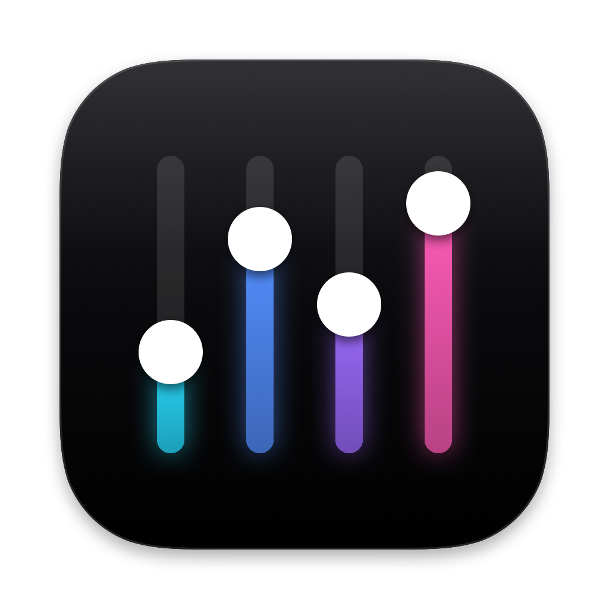
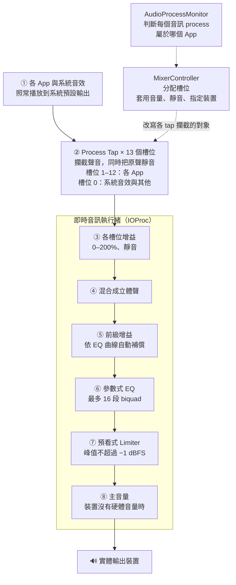
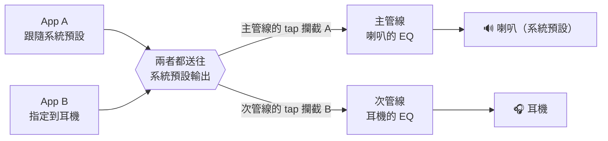

<p align="center">
  
</p>

<h1 align="center">SoundDeck</h1>

<p align="center">
  macOS 選單列音訊工具：系統等化器、依 App 混音、輸出裝置管理。<br>
  不需要安裝任何音訊驅動程式。
</p>

---

## 功能

| 功能 | 說明 |
|---|---|
| **參數式等化器** | 最多 16 個頻段，六種濾波器（鐘形、低頻擱架、高頻擱架、高通、低通、陷波），可拖曳的頻率響應曲線 |
| **頻譜分析儀** | 在 EQ 曲線後面即時顯示目前播出的聲音在各頻率的音量，手動微調時能看出該加強或衰減哪裡 |
| **每個裝置各自的 EQ** | 耳機、喇叭、soundbar 各記一組，切換輸出時自動套用 |
| **EQ 預設組** | 內建平坦、低音加強、高音加強、人聲清晰、樂團、小音量補償；可儲存、改名、刪除自訂預設組 |
| **匯入 EQ** | 匯入 [AutoEQ](https://github.com/jaakkopasanen/AutoEq) 的耳機校正檔；或複製範本請 AI 依你常聽的音樂產生參數，把回覆貼回來就能套用 |
| **App 混音器** | 每個正在發聲的 App 一列，各自調整音量（0–200%）與靜音，並顯示即時電平 |
| **依 App 指定輸出裝置** | 例如音樂走喇叭、通話走耳機。總開關預設關閉；可一鍵全部還原為系統預設 |
| **輸出裝置管理** | 一鍵切換系統輸出；HDMI 螢幕等沒有音量控制的裝置也能調音量（自動改用軟體音量） |
| **左右聲道平衡** | 每個輸出裝置各自記住 |
| **限幅器** | EQ 加強或 App 音量超過 100% 時，把峰值壓在 −1 dBFS 以下，避免爆音 |
| **自動更新** | 有新版時提示下載安裝（可關閉） |
| **其他** | 開機自動啟動、休眠喚醒後自動恢復、音量異常暴衝時自動停用 |

介面有繁體中文與英文，依系統語言自動切換；其他語言的系統會顯示英文。
也可以在「系統設定 → 一般 → 語言與地區 → 應用程式」單獨指定 SoundDeck 的語言。

## 系統需求

- macOS 15 Sequoia 以上
- Apple 晶片或 Intel 的 Mac 皆可

## 安裝

### 下載安裝

1. 到本專案的 [Releases](../../releases) 頁面下載最新的 `SoundDeck-<版本>.dmg`。
2. 打開 dmg，把 **SoundDeck** 拖到「**應用程式**」資料夾。
3. 從「應用程式」打開 SoundDeck。第一次會被系統擋下，顯示「Apple 無法驗證……」，這是正常的（原因見下方說明）：
   1. 按「完成」關掉提示。
   2. 打開「**系統設定 → 隱私權與安全性**」，捲到最下面，在 SoundDeck 的訊息旁按「**仍要打開**」（Open Anyway），再輸入登入密碼確認。
   3. 之後就可以正常打開，不會再出現這個提示。
4. 系統會詢問是否允許 SoundDeck 錄製**系統音訊**，請按「允許」。沒有這個權限就無法處理聲音，
   原因與 SoundDeck 如何使用它，見下方的[隱私](#隱私)。
5. 選單列出現 SoundDeck 的圖示（三條垂直推桿）就代表開始運作了。

之後有新版本時，SoundDeck 會自動提示，按「安裝更新」即可，不需要再重新下載 dmg。
也可以在控制面板底部按「檢查更新…」。

> **為什麼會被擋？** 這個 App 沒有經過 Apple 公證（需要付費的 Apple Developer 帳號），
> 所以系統無法確認開發者身分。程式碼都在這個 repo 裡，也可以自己從原始碼建置。
>
> 如果找不到「仍要打開」，也可以在「終端機」執行下面這行解除隔離標記，再打開 App：
>
> ```bash
> xattr -dr com.apple.quarantine /Applications/SoundDeck.app
> ```

## 隱私

SoundDeck 需要「螢幕與系統音訊錄製」權限，看起來像是會錄音，所以這裡說清楚它做什麼、不做什麼。

**為什麼需要這個權限**：等化器和混音器要先拿到各 App 的聲音，才能調整後再播出來。macOS 規定，
任何要讀取別的 App 聲音的程式都必須取得這類權限，同類的系統等化器工具也都一樣
（改用虛擬音訊驅動的做法，則是改要麥克風權限）。

**SoundDeck 不會做的事**

- 不會把聲音存成檔案。聲音只在記憶體裡即時處理，處理完就直接送到喇叭。
- 不會把聲音或任何個人資料傳到網路上。
- 不收集使用統計，也沒有任何分析或廣告套件。

**唯一會連網的功能是自動更新**：每天向 GitHub 下載一次 `appcast.xml` 檢查有沒有新版，
有新版時再從 GitHub Releases 下載 dmg。不會附帶任何系統資訊（已關閉 Sparkle 的系統資訊回報）。
在控制面板底部取消「自動檢查更新」後，除非你手動按「檢查更新…」，SoundDeck 完全不會連網。

**怎麼自己確認**

- 程式碼全部公開。和網路有關的只有 [`Sources/App/Updater.swift`](Sources/App/Updater.swift) 裡呼叫 Sparkle 的部分；
  其餘程式碼沒有任何連網或寫入音訊檔的程式。
- 可以用 [LuLu](https://objective-see.org/products/lulu.html)、Little Snitch 這類防火牆觀察：
  SoundDeck 只會連到 `raw.githubusercontent.com`（檢查更新）與 `github.com`（下載更新）。
- 可以從原始碼自己建置，或比對 Release 附上的 SHA-256 校驗碼，確認下載的檔案沒有被改過。
- 權限隨時可以在「系統設定 → 隱私權與安全性 → 螢幕與系統音訊錄製」關閉。
  關閉後 SoundDeck 收不到任何聲音，聲音會直接照原本的方式播放。

### 從原始碼建置

需要 macOS 15 以上與 Xcode（只有 Command Line Tools 也能建置，但只會產生本機架構的版本）。

```bash
git clone <這個 repo 的網址>
cd SoundDeck
./Scripts/install.sh        # 建置、安裝到「應用程式」並啟動
```

建議先建立一張固定的簽章憑證，否則**每次重新建置後系統都會再問一次錄音權限**（見[開發](#開發)）。

## 使用方式

點選單列的 SoundDeck 圖示打開控制面板：

- **右上角開關**：整個 SoundDeck 的總開關。關閉後聲音直接輸出，不經過任何處理。
- **主音量**：目前輸出裝置的音量。裝置本身沒有音量控制時（例如 HDMI 螢幕）會自動改用軟體音量。
- **平衡**：主音量下方的 L／R 滑桿，按右邊的文字回到置中。
- **輸出裝置**：點一下切換系統輸出。
- **混音器**：各 App 的音量、靜音與電平。
  - 打開「依 App 指定裝置」後，每一列多一個喇叭圖示，可以把該 App 指定到其他裝置。
  - 已指定的裝置拔掉時，該 App 暫時改走系統預設，裝置接回後自動搬回。
  - 「系統音效與其他」收的是通知音、系統音效等無法歸屬到某個 App 的聲音。
- **等化器**：切換預設組，或按「編輯…」打開編輯器。
  - 拖曳控制點調整頻率與增益；按住 `Shift` 拖曳可以微調；雙擊控制點把增益歸零。
  - 編輯器上方可以選擇要調哪個輸出裝置的 EQ。
  - 曲線後面的灰色區域是頻譜：目前正在播的聲音在各頻率有多大聲。播一首常聽的歌，
    哪裡太突出就在那裡衰減，哪裡不夠就加強。只有正在編輯的裝置正在播放時才會出現，可以用「顯示頻譜」關掉。
  - 按編輯器右上角的「**匯入**」可以匯入設定，見下一節。

### 匯入 EQ 設定

匯入視窗接受 Equalizer APO 的參數式 EQ 格式，也就是 AutoEQ `ParametricEQ.txt` 的格式：

```
# 名稱: 樂團
Preamp: -3.0 dB
Filter 1: ON LSC Fc 90 Hz Gain 3.0 dB Q 0.71
Filter 2: ON PK Fc 250 Hz Gain -1.5 dB Q 1.40
Filter 3: ON HSC Fc 9000 Hz Gain 2.0 dB Q 0.71
```

**耳機校正（AutoEQ）**：AutoEQ 依量測資料替數千款耳機算好了「把頻率響應拉平」的 EQ。
到 [AutoEQ 的 results 資料夾](https://github.com/jaakkopasanen/AutoEq/tree/master/results)找到你的耳機型號，
下載 `<型號> ParametricEQ.txt`，在匯入視窗按「選擇檔案…」。AutoEQ 提供的本來就是參數式 EQ，
SoundDeck 會照原始數值套用，不需要轉換成固定頻段。

**請 AI 幫你調**：

1. 在匯入視窗按「**複製給 AI 的範本**」。範本已經寫好 SoundDeck 能接受的格式與數值範圍，
   也會帶入目前的裝置名稱；如果你已經調過 EQ，也會附上目前的設定讓 AI 在這個基礎上修改。
2. 貼給 ChatGPT、Claude 等 AI，把括號裡的內容改成你的播放裝置、常聽的音樂和想要的效果。
3. 把 AI 的**整段回覆**貼回匯入視窗（或按「從剪貼簿貼上」）。SoundDeck 只讀取格式正確的那幾行，其他說明文字會自動略過。
4. 確認預覽沒問題後，按「套用」或「套用並存為預設組」。

匯入時超出範圍的數值會被調整到範圍內、不支援的濾波器類型會略過，預覽中都會列出。
檔案裡寫的 Preamp 只供參考，匯入後前級增益一律由自動補償計算。

「複製目前的設定」會把目前的 EQ 轉成同樣的文字格式，可以分享給朋友，對方用同一個視窗匯入。

## 運作原理

### 整體流程

SoundDeck 不安裝虛擬音訊裝置，而是用 macOS 14.2 起提供的 **Core Audio Process Tap** 攔截各 App 的聲音，
處理後再從實體裝置播出：



1. **攔截**：每個 tap 會攔截指定 process「送往某個輸出裝置」的聲音，並在讀取期間把原聲靜音。
   SoundDeck 停止讀取（關閉、當掉）時，系統聲音會自動恢復原本的直接輸出，不會變成沒聲音。
2. **槽位**：每條管線固定掛 13 個 tap。槽位 1–12 各給一個 App；槽位 0 用「排除模式」，
   收所有沒有被分配的聲音，所以 EQ 仍然作用在全部聲音上。
3. **處理**：建立一個 private aggregate device（子裝置是實體喇叭，tap 是它的輸入），
   在它的 IOProc 裡依序做增益、混合、前級、EQ、Limiter、音量，再寫到喇叭。
4. **動態調整**：App 開始或停止發聲時，只改寫 tap「攔截誰」，不需要重建裝置，聲音不會中斷。

### App 被指定到其他裝置時

App 永遠是往**系統預設輸出**播放的。把某個 App 指定到另一個裝置，做法是在那個裝置的管線裡
攔截「這個 App 送往系統預設輸出」的聲音，再從那個裝置播出：



- **主管線**接在系統預設輸出上，SoundDeck 啟用時一定存在。
- **次管線**在有 App 被指定到其他裝置時才建立，沒有 App 用到時自動拆除。
- 每條管線有自己的 EQ，這就是「每個裝置各自的 EQ」的由來。
- App 在管線之間搬移時採「新的先接手、舊的再放掉」，寧可一瞬間重疊也不讓原聲漏出。

### 為什麼不用虛擬音訊驅動

| | 虛擬音訊驅動 | Core Audio Process Tap（SoundDeck） |
|---|---|---|
| 安裝 | 要用管理員權限安裝驅動、重啟音訊服務 | 不用安裝任何東西，只要允許錄音權限 |
| 依 App 分離 | 驅動要自己辨識是哪個 App | API 本身就能指定 process |
| 當掉時 | 系統輸出可能卡在虛擬裝置上，變成沒聲音 | 自動恢復原本的輸出 |
| 系統音量鍵 | 控制的是虛擬裝置 | 仍然直接控制實體裝置 |
| 缺點 | 維護成本高，系統更新容易壞 | 需要 macOS 14.2 以上；API 新、文件少 |

## 設計細節

<details>
<summary><b>判斷聲音屬於哪個 App</b></summary>

瀏覽器、Electron App 的聲音實際上是 helper process 發出的（例如 `Google Chrome Helper`、`com.apple.WebKit.GPU`）。
判斷順序：

1. 音訊 process 自己
2. 系統記錄的「負責的 process」（`responsibility_get_pid_responsible_for_pid`，非公開 API，以 `dlsym` 取得，取不到時略過）
3. 往上找父 process

第一個是一般 App 的就是擁有者。包在別的 App 裡面的 helper（例如 `Discord.app/Contents/Frameworks/Discord Helper.app`）
雖然系統也把它當成 App，但會繼續往上找到外層的主程式。

不用「bundle ID 是不是 `com.apple.*`」來排除系統程式，因為 Safari、音樂、Podcast 也都是 `com.apple.*`。

</details>

<details>
<summary><b>混音器何時顯示一個 App</b></summary>

- 正在發聲，或停止發聲 30 秒內（以灰色顯示，暫停時也能先調好音量）。
- 音量、靜音或指定裝置被調整過的 App，只要還在使用音訊就一直顯示，也會預先佔好槽位，所以被靜音的 App 一開始發聲就不會漏音。
- 設定依 bundle ID 記住，App 重開後沿用。

</details>

<details>
<summary><b>即時執行緒</b></summary>

IOProc 跑在即時音訊執行緒上，不能配置記憶體、不能等待鎖，否則會爆音：

- 所有緩衝區與狀態在管線建立時就配置好，IOProc 只拿到指標，裡面沒有 ARC。
- EQ 係數由 UI 執行緒計算，透過 `os_unfair_lock` 交接；即時端只用 `trylock`，搶不到就沿用舊參數，下一個緩衝區再試。
- 係數、增益、音量的變動都在一個緩衝區內線性過渡，拖曳 EQ 或滑桿時不會有雜音。
- 電平表的峰值由即時端寫入，只有控制面板開著時 UI 才讀取。

</details>

<details>
<summary><b>Limiter</b></summary>

預看式峰值限幅器，左右聲道連動：訊號延遲約 0.67 ms，增益在峰值抵達之前就線性降到位，
釋放時間常數約 120 ms。演算法保證輸出不超過 −1 dBFS（有單元測試驗證），不需要另外的軟削波。

</details>

<details>
<summary><b>安全機制</b></summary>

- **只攔截送往特定裝置的聲音**：不使用全域 tap。若系統裡有其他音訊轉送工具（虛擬裝置 → 實體喇叭），
  全域 tap 會把它轉送的聲音再抓一次、送回去，形成回授。
- **回授保護**：任何一個 tap 的原始訊號超過 +12 dBFS 或出現 NaN，即時端立刻改輸出靜音，引擎隨後停用並在介面說明原因。
- **沒有音訊流動**：管線啟動 20 秒內都沒有收到音訊（多半是還沒允許錄音權限），會顯示原因並每 5 秒自動重試。
- **休眠與喚醒**：休眠前主動拆除管線，喚醒約 1 秒後重建，失敗時以 1、2、4 秒的間隔重試。

</details>

<details>
<summary><b>聲道（立體聲、5.1、7.1）</b></summary>

管線的聲道數等於輸出裝置的聲道數。tap 攔截到的格式和裝置相同，所以每個聲道照原位置混合、處理、送出，不做降混：
5.1 裝置上，中置（對白）、重低音、環繞聲道都保持在原本的位置。

- **EQ**：同一組參數套用到每個聲道，各聲道有自己的濾波器狀態。
- **Limiter**：同時看所有聲道，任何一個聲道太大聲時全部一起壓低，各聲道的比例不變，空間感不會偏移。
- **平衡**：依裝置回報的聲道配置，偏左時衰減右側的聲道（右前、右環繞……），中置與重低音不受影響。
  裝置回報的配置不完整時，立體聲視為左右，6／8 聲道視為標準的 5.1／7.1 排列。
- **頻譜**：顯示所有聲道的平均。

裝置是立體聲時，播放 5.1 內容的 App 或 macOS 會先自行降混再送出，這一步發生在 SoundDeck 之前，與是否使用 SoundDeck 無關。

</details>

## 已知限制

- 支援多聲道輸出裝置（5.1、7.1 等，最多 16 聲道），但目前只用模擬的 5.1 裝置做過測試，還沒有在實際的環繞音響上驗證。
- 播放器把 Dolby Digital、DTS、Atmos 等**原始編碼資料直接傳給擴大機**（passthrough）時，那是壓縮過的資料而不是聲音波形，
  SoundDeck 無法處理，任何系統等化器都一樣。
- 同時最多 12 個 App 有自己的一列，超過的會併入「系統音效與其他」。
- 每條管線有 13 個 tap，同時使用的輸出裝置越多，系統音訊服務（`coreaudiod`）的負擔越大。
- 被指定的裝置若沒有硬體音量，只有在它是系統預設輸出時才能調它的主音量（指定過去的 App 可以用自己那一列的滑桿調）。
- 次管線啟動後若一直沒有音訊流動，不會自動重試（主管線會）；此時該 App 的聲音會留在系統預設輸出。
- 部分 HDMI 裝置的管線啟動時間不穩定（從不到 1 秒到 20 秒以上都有），目前靠自動重試恢復，原因未查明。
- 少數專業錄音介面把聲道分在多個串流上，目前只處理第一個串流。
- 與其他會攔截或轉送系統聲音的工具（其他系統等化器、音訊路由工具）同時使用沒有意義，建議擇一。
- 左右平衡在 SoundDeck 的管線裡處理，音訊處理關閉時不會作用。
- 自動更新只在 Sparkle 的流程上做過測試，還沒有經過一次真正的「舊版收到通知並更新成新版」。

## 開發

### 專案結構

```
SoundDeck/
├── Package.swift
├── Sources/
│   ├── AudioCore/                 # 不依賴 UI 的音訊核心
│   │   ├── HAL/                   # Core Audio 屬性存取的薄包裝
│   │   ├── Devices/               # 輸出裝置列舉、切換、主音量、軟體音量
│   │   ├── Processes/             # 音訊 process 列舉與 App 歸屬判定
│   │   ├── Tap/                   # Process Tap
│   │   ├── Pipeline/              # OutputPipeline：單一輸出裝置的 aggregate device、IOProc、即時處理
│   │   ├── DSP/                   # Biquad、參數式 EQ、Limiter、EQ 設定與預設組、匯入匯出格式
│   │   ├── Mixer/                 # MixerController：槽位分配、各 App 音量與指定裝置
│   │   └── Engine/                # AudioEngine：管理多條管線與路由
│   └── App/                       # SwiftUI：選單列面板、混音器、EQ 編輯器、自動更新
├── Tests/AudioCoreTests/          # DSP、匯入格式與歸屬判定的單元測試
├── Resources/                     # Info.plist、App 圖示、en.lproj／zh-Hant.lproj 翻譯
├── LICENSE                        # MIT 授權
└── Scripts/                       # 建置、打包、簽章、圖示
```

### 腳本

| 指令 | 用途 |
|---|---|
| `./Scripts/bundle.sh [release\|debug]` | 建置並組裝 `build/SoundDeck.app`。release 為 Apple 晶片＋Intel 的 universal 版本 |
| `./Scripts/install.sh` | 建置、安裝到 `/Applications` 並啟動 |
| `./Scripts/make-dmg.sh` | 打包成 `build/SoundDeck-<版本>.dmg` |
| `./Scripts/set-version.sh <版本號>` | 設定版本號，並把建置編號加一 |
| `./Scripts/setup-updates.sh` | 建立自動更新用的簽章金鑰（只需執行一次） |
| `./Scripts/release.sh` | 打包、替更新檔簽章，並更新 `appcast.xml` |
| `python3 Scripts/check-localization.py` | 檢查介面文字有沒有漏翻成英文 |
| `./Scripts/create-signing-cert.sh` | 在登入鑰匙圈建立自簽的程式碼簽章憑證 `SoundDeck Dev` |
| `./Scripts/make-icon.sh` | 由 `make-icon.swift` 重新產生 App 圖示 |
| `swift test` | 執行單元測試 |

### 簽章與錄音權限

macOS 的錄音權限綁定程式簽章。沒有憑證時 `bundle.sh` 會用 ad-hoc 簽章，每次建置的簽章都不同，
所以**每次重新建置後都要重新允許一次**。先執行一次：

```bash
./Scripts/create-signing-cert.sh
```

它會建立一張只在本機有效、只信任於「程式碼簽章」用途的自簽憑證（過程中系統會要求輸入登入密碼），
之後 `bundle.sh` 會自動使用它。也可以用環境變數 `SOUNDDECK_SIGN_IDENTITY` 指定其他憑證。

### 自動更新的運作方式

使用 [Sparkle](https://sparkle-project.org)。App 每天檢查一次 repo 裡的 `appcast.xml`，
裡面列出各版本的版本號與 dmg 下載網址（GitHub Releases）。每個 dmg 都用 EdDSA 私鑰簽章，
App 內建對應的公鑰（`Info.plist` 的 `SUPublicEDKey`），簽章不符的更新會被拒絕。

第一次發佈前，先在這台電腦執行一次：

```bash
./Scripts/setup-updates.sh
```

它會在登入鑰匙圈建立私鑰，並把公鑰寫進 `Info.plist`。**私鑰遺失就無法再推送更新給已安裝的人**，
請依腳本最後的提示把私鑰匯出備份（不要放進 repo）。沒有設定公鑰的版本（例如別人自己建置的）
不會啟用自動更新，也不會顯示「檢查更新…」。

`appcast.xml` 的網址預設是 `kawaisumi/SoundDeck` 這個 repo；repo 名稱不同時，
要同時修改 `Info.plist` 的 `SUFeedURL` 與執行 `release.sh` 時的環境變數 `SOUNDDECK_GITHUB_REPO`。

### 發佈新版本

1. 設定版本號：`./Scripts/set-version.sh 1.1.0`。版本號採「主版本.次版本.修正版本」：
   修正 bug 加最後一碼（1.0.0 → 1.0.1），新增功能加中間一碼（1.0.1 → 1.1.0）。腳本也會把內部建置編號加一。
2. 執行 `./Scripts/release.sh`：打包 dmg、替它簽章、在 `appcast.xml` 加上這個版本，最後列出校驗碼。
3. 依腳本列出的順序完成：commit 並打 tag → 推送 tag → 在 GitHub 建立 Release 並上傳 dmg →
   最後才推送 `main`。順序很重要：`appcast.xml` 一推上去，已安裝的人就會收到通知，
   這時 dmg 必須已經可以下載。

目前的版本號顯示在控制面板右下角「結束」按鈕的左邊；滑鼠停在上面會顯示建置編號。

請一直用**同一張憑證**簽章發佈的版本。換了憑證，已安裝的使用者更新後要重新允許錄音權限。
建議從「鑰匙圈存取」把 `SoundDeck Dev` 匯出成 `.p12` 備份起來（不要放進 repo）。

### 診斷

```bash
# 每 2 秒記錄各管線、各 App 的電平
open build/SoundDeck.app --args --log-stats
/usr/bin/log stream --predicate 'subsystem == "local.sounddeck.app"' --style compact

# 列出偵測到的輸出裝置／混音器會顯示的 App，然後結束
./build/SoundDeck.app/Contents/MacOS/SoundDeck --dump-devices
./build/SoundDeck.app/Contents/MacOS/SoundDeck --dump-apps

# 把選單列面板與 EQ 編輯器開成一般視窗，並在 4 秒後存成 PNG（可加 -AppleLanguages "(en)" 檢查英文版）
open build/SoundDeck.app --args --preview --preview-snapshot <資料夾>

# 啟動 8 秒後把指定 App 送到指定裝置，10 秒後還原
open build/SoundDeck.app --args --log-stats --route-test <App 的 bundle ID> <裝置名稱>
```

## 開發紀錄

| 階段 | 內容 |
|---|---|
| M0 | 概念驗證：Process Tap + aggregate device 轉送系統聲音、回授保護 |
| M1 | 輸出裝置管理、軟體音量、休眠喚醒、啟動失敗自動重試 |
| M2 | 參數式 EQ、預看式 Limiter、EQ 編輯器、內建預設組 |
| M3 | App 混音器：固定 13 個 tap 槽位、helper process 歸屬判定 |
| M4 | 依 App 指定輸出裝置、多條管線、每個裝置各自的 EQ |
| M5 | 自訂預設組、開機自動啟動、介面整理、App 圖示、dmg 打包 |
| M6 | 匯入 AutoEQ／Equalizer APO 格式、給 AI 的參數範本、匯出目前設定 |
| M7 | 左右聲道平衡、自動更新（Sparkle）、頻譜分析儀、英文介面 |
| M8 | 多聲道輸出（5.1、7.1 等）：每個聲道照原位置處理，不再只保留前方左右 |

### 之後可能做的

- 全域快捷鍵（切換裝置、開關 EQ、切換預設組）
- App 內直接搜尋 AutoEQ 耳機（目前要先到網站下載檔案）
- 輸入裝置（麥克風）的選擇與音量
- 依 App 獨立的 EQ
- 圖形式 EQ（固定 10 段的簡易介面）

## 參考資料與致謝

- [Sparkle](https://sparkle-project.org)：自動更新（MIT 授權，授權全文附在 App 內的 `Contents/Resources/Licenses/`）
- [AutoEQ](https://github.com/jaakkopasanen/AutoEq)：耳機校正資料的格式
- [Audio EQ Cookbook](https://webaudio.github.io/Audio-EQ-Cookbook/audio-eq-cookbook.html)（Robert Bristow-Johnson）：biquad 濾波器係數公式
- Apple Core Audio：`AudioHardwareCreateProcessTap`、`CATapDescription`（見 SDK 中的 `AudioHardwareTapping.h`、`CATapDescription.h`）

## 授權

[MIT License](LICENSE)。可以自由使用、修改與散布，包含商業用途，只要保留原本的版權與授權聲明。
本軟體按現狀提供，不提供任何擔保。
